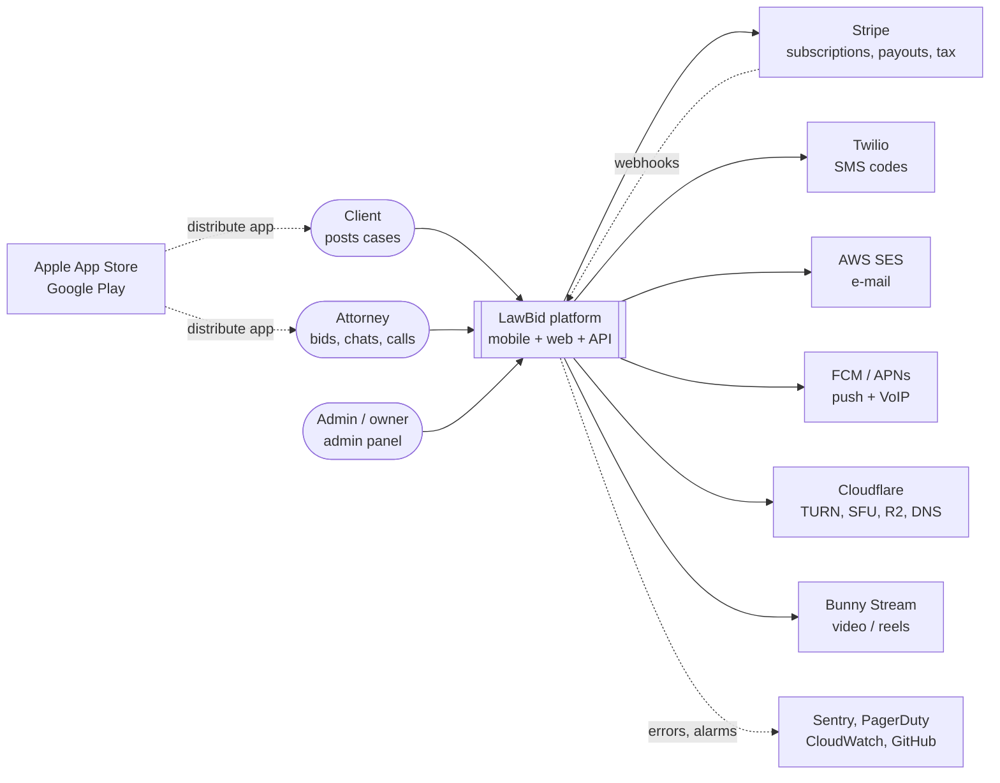
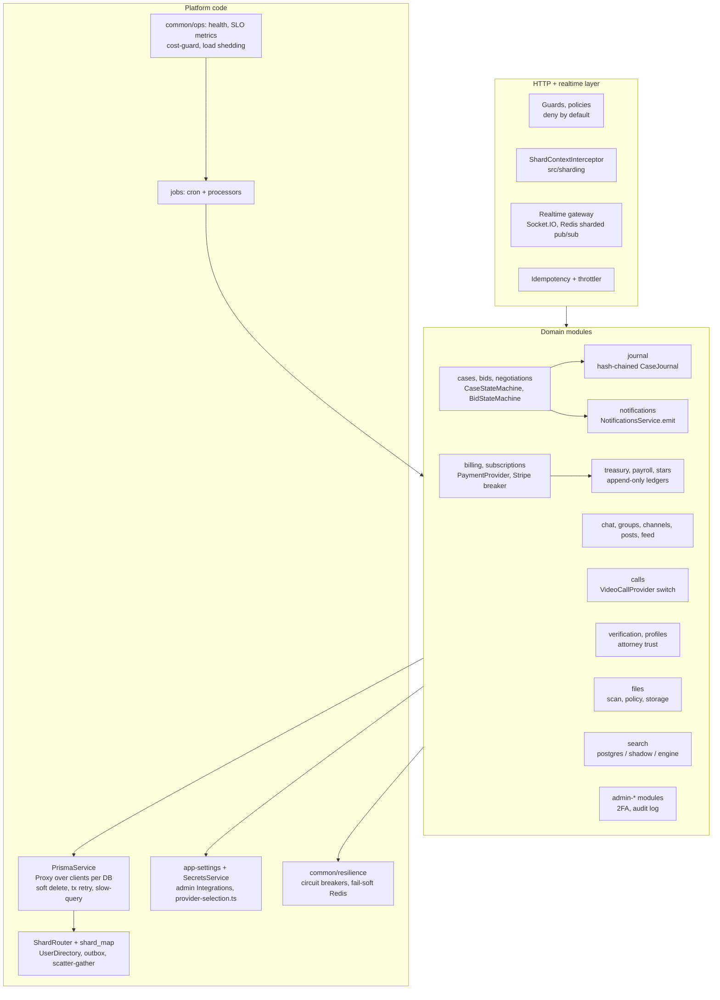
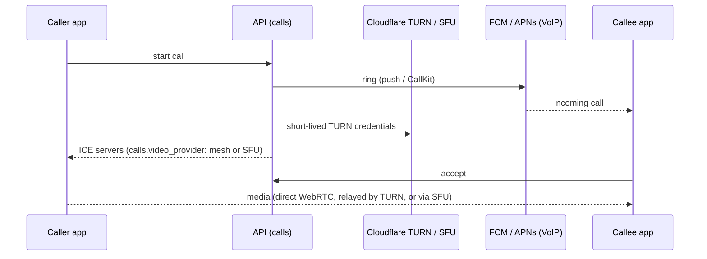

# Архитектура LawBid в схемах (C4)

## Резюме для владельца (по-русски)

Это карта системы в трёх масштабах: «кто с кем говорит» (уровень 1), «из каких
программ и хранилищ она состоит» (уровень 2) и «что внутри сервера» (уровень 3).
Схемы нарисованы текстом (Mermaid): GitHub показывает их картинками, а менять их
можно прямо в файле. Всё взято из реального кода и Terraform, ничего не выдумано.
Если что-то на схеме расходится с кодом, прав код: поправьте схему в том же PR.

---

Method: the [C4 model](https://c4model.com/diagrams) (Simon Brown; levels
context, container, component, code; the site says context + container are
enough for most teams and the code level is better generated than drawn;
checked 2026-10-25). We draw levels 1-3 as Mermaid `flowchart` (Mermaid's
native C4 syntax is still marked experimental; `flowchart` renders everywhere).
Decisions behind the shapes are in [docs/adr/](../adr/README.md). Vendors,
status pages and exit plans are in [VENDORS.md](../runbooks/VENDORS.md).

Legend: solid arrow = request/response, dotted = async (queue, webhook, event),
`[(x)]` = data store. Parts marked "switch" can be turned on or off in the
admin (Settings) without a deploy.

## Level 1 - System context

## Level 2 - Containers

Everything we run in AWS (one region, two availability zones) and every
managed service it talks to. Terraform modules are in `infra/modules/`.

```mermaid
flowchart TB
  subgraph users[People]
    app[Flutter app<br/>iOS / Android / web<br/>apps/mobile]
    adminui[Admin panel<br/>Next.js on ECS<br/>apps/admin]
  end

  subgraph edge[Edge]
    cfdns[Cloudflare DNS<br/>DNS only, grey cloud]
    cdn[CloudFront + WAF<br/>web app, private media]
    alb[ALB + WAF<br/>HTTPS, WebSockets]
  end

  subgraph aws[AWS - ECS Fargate]
    api[API service<br/>NestJS REST + Socket.IO<br/>apps/api src/main.ts]
    worker[Worker service<br/>BullMQ queues + cron<br/>src/worker.ts]
    migr[Migrate task<br/>prisma migrate deploy<br/>one-off]
    pgb[PgBouncer x2-3<br/>own pooler, switch]
  end

  subgraph data[Data]
    pg[(PostgreSQL 16 RDS<br/>global + logical shards<br/>autoscale Lambda)]
    redis[(Redis 7 ElastiCache<br/>queues, sockets, locks<br/>autoscale Lambda)]
    rcache[(Redis cache<br/>allkeys-lru)]
    s3[(S3 + KMS<br/>private documents, media)]
    os[(OpenSearch<br/>switch, off)]
  end

  subgraph ext[Managed services]
    r2[(Cloudflare R2<br/>public media, switch)]
    cftr[Cloudflare Realtime<br/>TURN + SFU]
    bunny[Bunny Stream]
    stripe[Stripe]
    twilio[Twilio]
    ses[SES]
    fcm[FCM / APNs]
    rek[Rekognition, ClamAV<br/>Macie]
  end

  subgraph obs[Operations]
    cw[CloudWatch alarms + SNS]
    pd[PagerDuty Free]
    sentry[Sentry]
    gh[GitHub Actions<br/>CI, deploy, drift, load test]
  end

  app --> cfdns --> alb
  adminui --> alb
  app --> cdn
  app -. signed upload / download .-> s3
  app -. public photos .-> r2
  app -. video .-> bunny
  app -. media tracks .-> cftr
  alb --> api
  api --> pgb --> pg
  worker --> pgb
  migr --> pg
  api --> redis
  worker --> redis
  api --> rcache
  api -. search switch .-> os
  api --> s3
  api --> r2
  api --> cftr
  api --> bunny
  api --> stripe
  stripe -. webhooks .-> api
  worker --> twilio
  worker --> ses
  worker --> fcm
  worker --> rek
  api --> sentry
  cw --> pd
  gh -. deploy images .-> aws
```

Notes taken from the code:

- **One image, two roles.** `api` serves HTTP and WebSockets; `worker`
  (`node dist/src/worker.js`) runs the BullMQ queues and the cron scheduler.
  `JOBS_ENABLED=true` lets the API also run jobs (local dev); production runs
  the dedicated worker.
- **Queues** (BullMQ on Redis): `cron`, `push`, `files` (virus scan),
  `stripe-webhooks`, `subscriptions`, `channel-fanout`, `group-fanout`,
  `admin-broadcast`, `media-moderation`, `data-export`, `account-deletion`,
  `case-history-export`.
- **Database families** ([SHARDING_READY.md](SHARDING_READY.md),
  [ADR-0003](../adr/0003-logical-shards-and-families.md)): `global` (users, auth,
  billing, admin, config), `case` (cases, bids, case chat, calls), `user`
  (notifications, saved items), `content` (posts, channels). Today all 256
  logical shards live on the one `primary` database; `DATABASE_URL_SHARDS` and
  the planned admin split button are the road to more servers.
- **Pooler.** API and worker connect to PgBouncer by an internal name (AWS
  Cloud Map); migrations and one-off admin tasks connect straight to RDS
  ([DB_POOLER.md](DB_POOLER.md)).
- **Two Redis.** The main one has `noeviction` (queues must never lose jobs);
  the cache one is `allkeys-lru` (`REDIS_CACHE_URL`).
- **Private vs public files.** Private content (chat, case files, verification
  documents) is only on AWS S3 with KMS and signed links; a code test makes sure
  a private kind can never be sent to R2 ([R2_PUBLIC_MEDIA.md](R2_PUBLIC_MEDIA.md)).
- **No public status page yet** (see `docs/perf/SYSTEMS_CHECKLIST_2026-10-22.md`);
  the in-app on-call (`common/ops/status/incidents.service.ts`) pushes and
  e-mails admins.

## Level 3 - Components of the API container

Modules live in `apps/api/src/modules/<name>/`; `controller -> service ->
Prisma` is the rule (`.cursorrules`). The picture groups the ~100 modules.

Rules enforced by tests (not by good will), so the picture stays true:

- `src/architecture/module-boundaries.spec.ts`: a module may import only the
  root files of another module, and its fan-out may not grow.
- `src/sharding/shard-manifest.spec.ts`: every Prisma model has exactly one family.
- `src/sharding/cross-family-include.spec.ts`: no new relation include across families.
- `src/architecture/sql-safety.spec.ts`: raw SQL safety scan.

## Calls - the one dynamic flow worth drawing

If Cloudflare TURN fails, the API falls back to STUN only; if the SFU fails,
calls of 2-4 people fall back to mesh
([GROUP_CALLS_CLOUDFLARE_SFU.md](GROUP_CALLS_CLOUDFLARE_SFU.md)).
